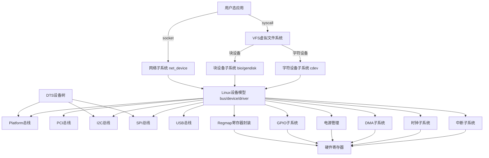

# Linux 内核驱动架构总览

Linux 驱动核心思想：**把硬件抽象成文件，统一用 VFS 接口（open/read/write/ioctl）访问**；驱动运行在内核态，分成「内核框架层 + 驱动实现层」，框架负责通用逻辑，驱动只写硬件相关代码。

整体分层（从上到下）：
```
用户态应用
    ↓ 系统调用
VFS 虚拟文件系统层
    ↓
字符设备 / 块设备 / 网络设备 子系统
    ↓
内核驱动框架（platform、PCI、I2C、SPI、USB、RTC、input 等总线框架）
    ↓
硬件操作（寄存器、DMA、中断、时钟、电源管理）
    ↓
硬件
```

## 一、三大基础设备类型

Linux 驱动按访问模型分为三类，是最基础分类：
### 1. 字符设备（char device）
- 流式、顺序访问，没有独立寻址块，**最常见**
- 接口：`cdev` 结构体，主设备号+次设备号标识
- 典型：串口、键盘、鼠标、LED、传感器、I2C/SPI 外设、 `/dev/ttyS0`、`/dev/led0`
- 核心操作集：`file_operations`（open/release/read/write/ioctl/poll）

### 2. 块设备（block device）
- 以**块（sector）**为单位随机读写，有缓存（page cache / bio）
- 核心：`block_device`、`gendisk`、`bio`（块IO描述符）、request 队列
- 典型：SSD、机械硬盘、eMMC、SD卡 `/dev/sda`
- 特点：IO 会排队、合并，支持预读；区分同步/异步IO

### 3. 网络设备（net device）
- 不经过 VFS，**没有设备文件**，单独网络子系统
- 核心：`net_device` 结构体，收发 sk_buff（网络包缓冲区）
- 典型：网卡、WiFi、虚拟网卡（tap/veth）
- 接口：协议栈直接调用 `ndo_start_xmit` 发包；硬件中断收包向上送协议栈

> 补充：还有一类**杂项设备 miscdevice**，本质是简化版字符设备，自动分配次设备号，写简单驱动常用。

## 二、总线驱动模型（Linux 驱动核心：Device Model）

Linux 2.6 引入 **LDM（Linux Device Model）**，核心：`bus / device / driver` 三角模型，统一管理所有硬件，支持热插拔、电源管理、sysfs。
- `struct bus_type`：总线（PCI、platform、I2C、SPI、USB、AMBA等）
- `struct device`：设备实例（硬件）
- `struct device_driver`：驱动代码
匹配规则：总线的 `match` 函数，匹配设备和驱动 → 匹配成功调用 `probe()`；拔掉设备调用 `remove()`。

### 重点总线框架

1. **Platform 平台总线（虚拟总线，最常用）**
    用于片上外设（SOC内部：UART、GPIO、TIMER、RTC），硬件没有独立标准总线；设备信息来自 **设备树DTS**（旧版：board文件）。
    ```
    DTS → platform_device → platform_driver -> probe
    ```
2. **PCI 总线**：PCIE 网卡、SSD、显卡，标准PCI枚举、BAR空间、MSI/MSI-X中断
3. **I2C 总线**：I2C 传感器、EEPROM，适配器(i2c_adapter) + i2c_client
4. **SPI 总线**：Flash、ADC，spi_master + spi_device
5. **USB 总线**：USB 设备，分层（usb host、usb device、usb gadget），支持热插拔
6. **AMBA（ARM）**：AHB/APB，ARM SOC内置外设

## 三、核心基础设施（所有驱动都依赖）
### 1. 设备树 DTS（Device Tree）
**硬件描述语言**，把硬件信息（寄存器地址、中断号、时钟、电源、引脚）从驱动代码剥离，做到驱动和板级信息分离。
- `.dts`：板级描述；`.dtsi`：SOC通用头文件
- 内核启动时解析DTS，生成 platform/i2c/spi 等 device
- 驱动在 `probe` 里用 `of_*` 接口读取资源

### 2. 中断子系统
- 中断控制器：GIC（ARM）、IOAPIC（x86）
- 驱动接口：`request_irq()` / `devm_request_irq()`（托管资源，推荐）
- 下半部机制（中断上下文不能跑长耗时代码）：
  - tasklet：简单、原子上下文
  - workqueue：可以睡眠，最常用
  - threaded irq：线程化中断

### 3. 时钟子系统 clk
`struct clk`，驱动打开/关闭、设置外设时钟频率，SOC必备。

### 4. 电源管理子系统 PM
- runtime PM：运行时动态开关硬件电源
- system sleep：suspend/resume 休眠唤醒
- dev_pm_ops：驱动提供 suspend/resume 回调

### 5. DMA 子系统
不用CPU搬运数据，硬件直接访问内存；`dma_alloc_coherent` 分配一致性内存，用于网卡、高速外设。

### 6. GPIO 子系统
gpiolib，统一操作引脚，DTS指定gpio，`gpiod_*` 系列API（推荐，淘汰旧gpio_*）

### 7. regmap（重点，简化I2C/SPI寄存器读写）
统一封装寄存器访问，不管底层是I2C/SPI/MMIO，驱动只写 regmap_read/write，减少重复代码。

## 四、sysfs、udev、devtmpfs

- sysfs：`/sys`，LDM的文件化呈现，bus/device/driver 目录，内核导出硬件属性
- devtmpfs：内核启动自动生成 `/dev` 下设备节点
- udev：用户态，根据内核uevent事件，自动创建设备节点、设置权限、加载固件

## 五、驱动的两种写法：传统驱动 vs 框架驱动

1. **裸写字符设备（cdev）**：直接注册cdev，自己处理设备号，适合理解原理，产品很少用
2. **总线框架驱动（推荐）**：基于platform/i2c/spi等框架，只写probe/remove，资源由框架传递，代码更规范、适配设备树、PM、热插拔

> 现代内核驱动标准范式：**DTS描述硬件 + 框架驱动（platform_driver/i2c_driver） + devm 托管资源（自动释放，防内存泄漏）**

## 六、内核驱动的上下文限制（非常关键）

- **中断上下文**：不能睡眠、不能调用阻塞函数（mutex、kmalloc带GFP_KERNEL）
- **进程上下文（probe、read/write、workqueue）**：可以睡眠，可以使用互斥锁
- 内核态不能直接访问用户态指针，必须用 `copy_to_user / copy_from_user`

## 七、一张精简架构图



## 八、学习路线建议

1. 先搞懂：字符设备 + file_operations + cdev
2. 理解设备模型：bus/device/driver、probe匹配
3. 设备树DTS语法，of 接口
4. platform驱动，devm资源管理
5. 中断、workqueue、regmap
6. I2C/SPI 驱动、块设备、网络驱动
7. 进阶：DMA、runtime PM、MSI、内核锁、trace、debugfs

如果你需要，我可以继续：
- 写一份极简可编译的 platform 字符驱动模板
- 或者单独拆解 块设备 / 网络驱动 / PCIe 驱动细节
- 或者整理成 Obsidian 知识卡片版本